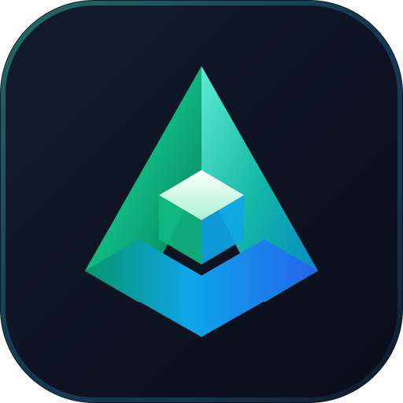
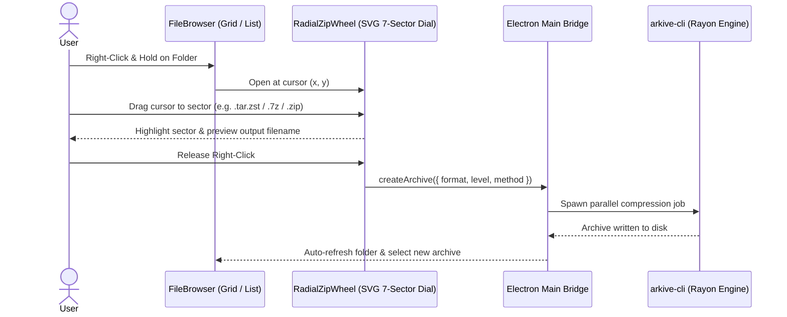
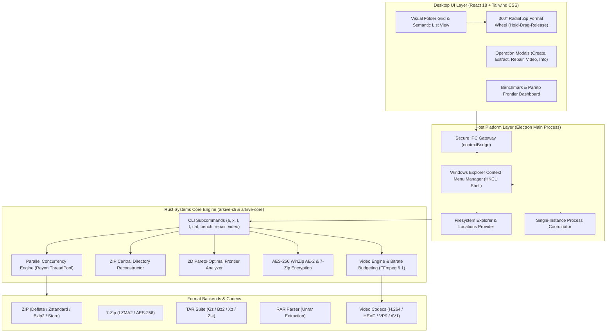

<p align="center">
  
</p>

<h1 align="center">Arkive</h1>

<p align="center">
  <strong>Modern Archive Studio, Radial Compression Engine & Media Transcoder</strong>
</p>

<p align="center">
  <a href="https://zeinboulo.github.io/arkive/"><strong>🌐 Official Website &amp; Interactive Demo</strong></a> ·
  <a href="https://github.com/Zeinboulo/arkive/releases/latest"><strong>⬇️ Download for Windows (Installer &amp; Portable)</strong></a>
</p>

<p align="center">
  <a href="https://opensource.org/licenses/MIT"></a>
  <a href="https://www.rust-lang.org/"></a>
  <a href="https://www.electronjs.org/"></a>
  <a href="https://react.dev/"></a>
  <a href="https://www.typescriptlang.org/"></a>
</p>

**Arkive** is an open-source, high-performance archive manager, systems compression engine, and video optimization studio built as a clean, modern replacement for legacy utilities like WinRAR and 7-Zip.

Powered by a **multi-threaded Rust core (`arkive-core` + `arkive-cli`)** and a calm **Nordic Jade & Ocean Slate desktop interface**, Arkive combines Finder-style visual folder browsing, a **Right-Click & Hold Radial Zip Format Wheel**, automated ZIP corruption recovery, FFmpeg video compression, and a Pareto-frontier codec benchmark suite.

---

## What's New in the Desktop Studio

### 1. Right-Click & Hold Radial Zip Format Wheel
Press and hold **Right-Click** on any folder or file (in either **Visual Grid View** or **List View**) to bloom the 360° **Radial Zip Format Wheel** directly under your cursor:
- **Hold-Drag-Release Gesture:** Drag toward any of the 7 sectors (`.zip`, `.7z`, `.tar.zst`, `.tar.gz`, `.tar.xz`, `ZIP (Zstd)`, or `Custom…`) and release **Right-Click** to immediately pack the folder in place.
- **Click & Keyboard Mode:** Quick-right-click to keep the wheel pinned open, then click a slice or press keys `1`–`7` (`Esc` to cancel).
- **Windows Explorer Integration:** Right-clicking any folder in Windows File Explorer (`Add to archive with Arkive...`) opens Arkive in that directory and automatically launches the Radial Zip Format Wheel for that folder.



### 2. Visual Folder Grid View + Semantic List View
- **Visual Folder Grid (Default):** Displays directories, archives, and media as tactile cards with custom layered Jade/Teal folder glyphs and archive badges.
- **Semantic List View:** 1-click toggle in the top bar switches to a high-density semantic data table with sticky column and row headers.
- **Contextual Quick-Compress Bar:** Selecting any folder reveals a bottom bar with 1-click format pills (`ZIP`, `7-Zip`, `TAR.ZST`, `TAR.GZ`, `TAR.XZ`, `ZIP (Zstd)`, `Custom…`).

### 3. Nordic Jade & Ocean Slate Dual Theme
- **Nordic Slate (Dark Default):** Low-glare cool slate surfaces (`#13181f` / `#181e26`) paired with **Jade-Emerald (`#10b981`)** and **Ocean-Teal (`#0d9488`)** accents.
- **Nordic Pearl (Light Mode):** 1-click Sun/Moon toggle in the navigation rail switches to a crisp daylight surface (`#f5f7fa` / `#ffffff`) persisted in `localStorage`.

---

## Architecture Overview



> 📖 **Deep Dive:** Read the complete [ARCHITECTURE.md](ARCHITECTURE.md) for sequence diagrams, threadpool mechanics, and algorithmic details.

---

## Feature Matrix

| Capability | Arkive | WinRAR | 7-Zip | PeaZip |
|---|:---:|:---:|:---:|:---:|
| **Modern Desktop UI** | ✅ Grid + List + Dual Theme | ❌ 1990s Win32 | ❌ 1990s Win32 | ⚠️ Qt/GTK |
| **Right-Click Hold Radial Format Wheel** | ✅ 7-Sector Instant Dial | ❌ No | ❌ No | ❌ No |
| **Open Source & Free License** | ✅ MIT | ❌ Proprietary ($39) | ✅ LGPL | ✅ LGPL |
| **Windows Explorer Right-Click Integration** | ✅ Yes (Native Shell) | ✅ Yes | ✅ Yes | ⚠️ Partial |
| **Cross-Format Support** (ZIP, 7z, TAR.*, RAR extract) | ✅ Full | ✅ Full | ✅ Full | ✅ Full |
| **Parallel ZIP Compression** (Rayon memory chunking) | ✅ Native | ⚠️ Limited | ✅ Multi-threaded | ⚠️ Limited |
| **Modern Data Codecs** (Zstandard, LZ4) | ✅ Built-in | ❌ No | ❌ (requires plugin) | ⚠️ Partial |
| **Data Engineering Benchmark Suite** | ✅ Built-in | ❌ No | ⚠️ CPU only | ❌ No |
| **Pareto-Optimal Frontier Analysis** | ✅ Built-in | ❌ No | ❌ No | ❌ No |
| **Damaged ZIP Central Directory Repair** | ✅ Local Header Scan | ⚠️ Basic | ❌ No | ⚠️ Basic |
| **Video Compression & Transcoding** (Discord <25MB, HEVC, AV1) | ✅ Built-in FFmpeg | ❌ No | ❌ No | ❌ No |
| **AES-256 WinZip AE-2 / 7z Encryption** | ✅ Yes | ✅ Yes | ✅ Yes | ✅ Yes |
| **Unified CLI (`arkive`)** | ✅ Built-in | ⚠️ Command prompt | ✅ `7z` | ⚠️ Scriptable |

---

## Data Engineering Highlights

1. **Storage vs. Compute Trade-Off Profiler:**
   When architecting columnar storage formats (Parquet, ORC) or table formats (Apache Iceberg, Delta Lake), choosing between **Zstandard**, **LZ4**, and **Deflate** has major cost implications. Arkive’s benchmark engine automatically identifies **Pareto-optimal** codecs (maximum ratio for minimum compute latency).
2. **Parallel Archive Pipeline:**
   Employs an in-memory batching architecture using **Rayon**: files are compressed concurrently across available CPU cores, then atomically assembled into the final container using zero-recompression raw byte copies.
3. **Automated Header Reconstruction:**
   Recovers truncated or corrupt ZIP streams by walking raw byte offsets, sniffing `PK\x03\x04` local file headers, validating CRC-32 checksums, and synthesizing a valid Central Directory and End-of-Central-Directory record.
4. **Zip-Slip Traversal Protection:**
   Guarantees safe unarchiving by sanitizing relative path traversal sequences (`..`), volume specifiers, and absolute path injection attempts.

---

## Installation & Build

### Prerequisites
- [Rust](https://www.rust-lang.org/) (1.70 or newer)
- [Node.js](https://nodejs.org/) (v18+)

### Building from Source

```bash
# Clone the repository
git clone https://github.com/Zeinboulo/arkive.git
cd arkive

# Build the CLI and Core library
cargo build --release

# Run unit and integration tests
cargo test
```

### Running the Native Desktop App

```bash
cd apps/desktop
npm install
npm run start
```

---

## CLI Usage Guide

### 1. Create Archives
```bash
# Create standard ZIP
arkive a backup.zip ./data ./logs

# Create ultra-compressed 7z archive with AES-256 encryption
arkive a secure_dataset.7z ./warehouse -l 9 -p "SecretPassword123"

# Create a TAR.ZST archive using multi-threaded Zstandard
arkive a snapshot.tar.zst ./lake --threads 8
```

### 2. Extract Archives
```bash
# Extract to target directory
arkive x archive.zip -o ./extracted_data

# Extract encrypted archive
arkive x secure_dataset.7z -p "SecretPassword123"
```

### 3. List, Verify & Repair
```bash
# Structured JSON listing
arkive l dataset.zip --json

# Verify CRC-32 checksums of all entries
arkive t data_lake_snapshot.zip

# Rebuild missing central directory on damaged ZIP
arkive repair broken_stream.zip -o recovered.zip
```

### 4. Benchmark & Video Compression
```bash
# Run benchmark on synthetic CSV event table
arkive bench --dataset csv --size 32

# Target Discord 25MB video upload limit
arkive video recording.mov --preset discord
```

---

## Project Structure

```
arkive/
├── crates/
│   ├── arkive-core/          # Pure archive engine (ZIP, 7z, TAR, RAR, Codecs, Benchmarks)
│   └── arkive-cli/           # Fast CLI binary (clap, indicatif, tabled)
├── apps/
│   └── desktop/              # Electron + React + Vite + Tailwind desktop application
│       ├── public/           # Origami Prism SVG/PNG/ICO brand assets
│       ├── resources/        # Native application icons
│       ├── src/              # React UI (Sidebar, FileBrowser, RadialZipWheel, Modals)
│       └── electron/         # Electron host process & Windows Shell integration
├── docs/
│   └── benchmarks.md         # Data engineering algorithm trade-off analysis
├── ARCHITECTURE.md           # Detailed system & concurrency diagrams
├── LICENSE                   # MIT License
└── README.md
```

---

## License

This project is licensed under the [MIT License](LICENSE).
